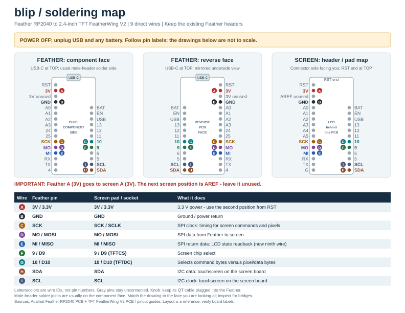

# Soldering map

[Printable PDF](../output/pdf/blip-soldering-map.pdf) - US Letter, landscape.

The first drawing shows the Feather's component face; with the usual male-header
installation, this is also where the short pin tails and their solder joints are.
The middle drawing shows the reverse face, not an assumed soldering face. Match
the drawing to the actual face you are looking at. Keep USB-C at the top
when flipping the board left-to-right. The screen drawing shows its header/pad
side, with the RST end at the top; it is not a drawing of the LCD face. These are
schematic pin maps, not board outlines or scale drawings.

Match letters A through I between boards. The letters and colors identify the
nine wires on this sheet, not GPIO numbers or physical header pin numbers.
The Feather's second 3V position is unused here; the screen's corresponding
position is AREF. Use the **second position from RST** for screen power.

Keep the Feather headers installed and solder wires to the existing pin joints.
The screen's square pads connect to the corresponding socket contacts. Unplug
USB and any battery before soldering; check for bridges between neighboring pins
and secure the wires so movement does not pull on the joints. The rotary board
keeps its existing QT cable to the Feather.

Positions and nets were checked against Adafruit's
[Feather RP2040 CAD](https://github.com/adafruit/Adafruit-Feather-RP2040-PCB) and
[TFT FeatherWing V2 CAD](https://github.com/adafruit/Adafruit-2.4-TFT-FeatherWing-PCB).
See the [Feather pinout](https://learn.adafruit.com/adafruit-feather-rp2040-pico/pinouts)
and [screen V2 pinout](https://learn.adafruit.com/adafruit-2-4-tft-touch-screen-featherwing/pinouts-v2)
for vendor reference images.

Regenerate the PDF and SVG with `python3 scripts/render-wiring-sheet.py` (requires
`reportlab`). The script defaults to macOS Arial fonts; on another platform, set
`BLIP_FONT` and `BLIP_FONT_BOLD` to paths to regular/bold TrueType fonts.
